# MoreSpeech

**The comment section is a public forum.**

A single-page site that explains why it is unlawful for federal officials to
block people from social-media accounts they use for public business — and
generates a printable set of court filings for someone it happened to.

Live at **[morespeech.online](https://morespeech.online)** ·
served from GitHub Pages at
**[morespeechonline.github.io](https://morespeechonline.github.io)**

No backend. No analytics. No network requests at runtime. The filings are
assembled in your browser and never leave it.

---

## Contents

| | |
|---|---|
| [`index.html`](index.html) | The built site — one self-contained file, served by GitHub Pages |
| [`docs/the-argument.md`](docs/the-argument.md) | The legal memorandum: liability, civil and criminal, with the weaknesses stated |
| [`docs/summary.md`](docs/summary.md) | The one-page version of the argument |
| [`docs/open-letter.md`](docs/open-letter.md) | The open letter to the Attorney General (generated from `src/letter.ts`) |
| [`docs/filings/`](docs/filings/) | The pro se filing packet: complaint, summons, IFP, injunction, order, service, opposition |
| [`src/`](src/) | TypeScript sources, styles, and the page template |
| [`test/`](test/) | Headless Chrome tests: smoke, print, and the screenshot tour |
| [`screenshots/`](screenshots/) | The tour, a gallery, and a contact sheet |
| [`about.html`](about.html) | About page: the ministry, how to send a gift in Monero or X Cash, and how the site was built |
| [`code-of-ethics.html`](code-of-ethics.html) | The Code of Ethics, as a page on the site (linked from every footer) |
| [`CODE_OF_ETHICS.md`](CODE_OF_ETHICS.md) | The same text, in Markdown |
| [`LICENSE`](LICENSE) | MIT |


## Screenshots

The whole flow, captured from the built page. A gallery is at
[`screenshots/index.html`](screenshots/index.html); a single overview image is at
[`screenshots/contact-sheet.png`](screenshots/contact-sheet.png).

| | |
|---|---|
| 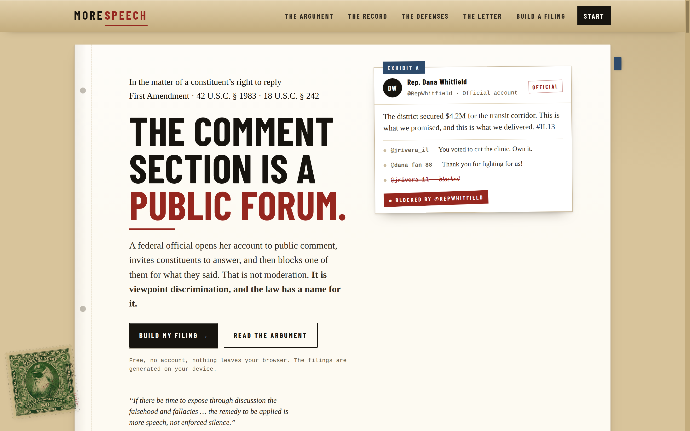 | 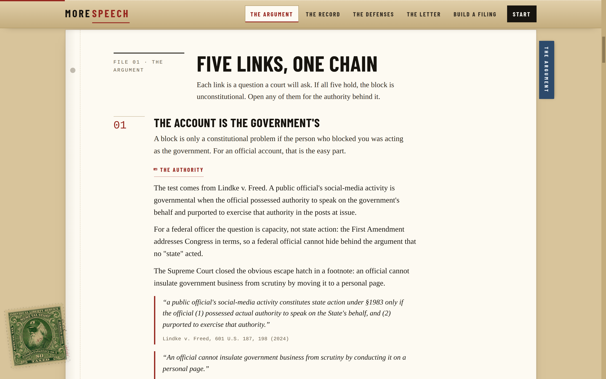 |
| **The claim.** A mock post with one critic struck through, and the tagline the project is named for. | **The argument.** Five links; each opens to the authority behind it. |
| 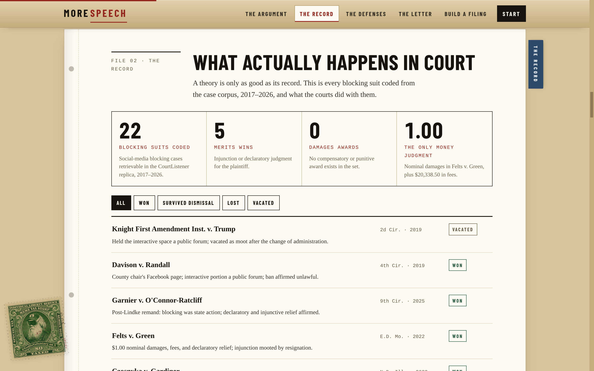 | 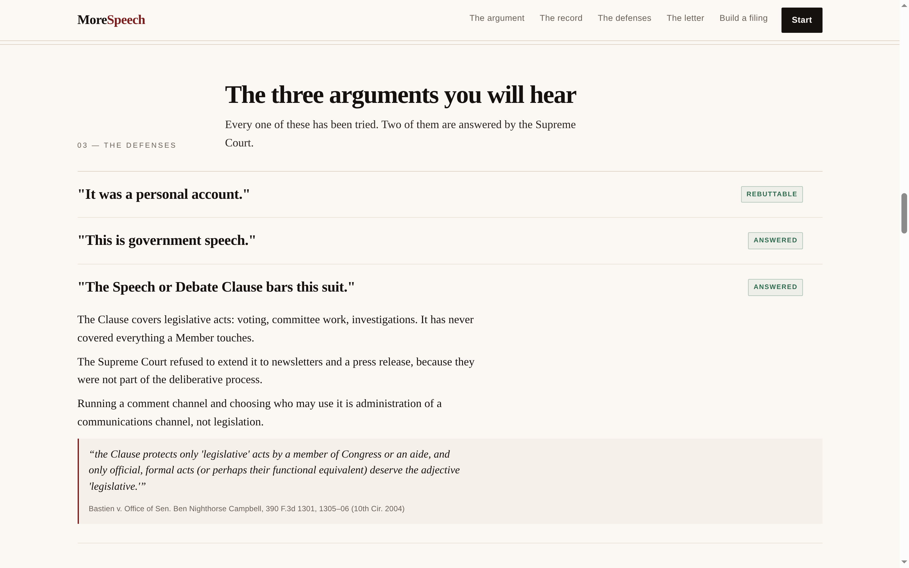 |
| **The record.** Twenty-two coded suits, five merits wins, no damages awards. | **The defenses.** The Speech or Debate answer, with *Bastien*. |
| 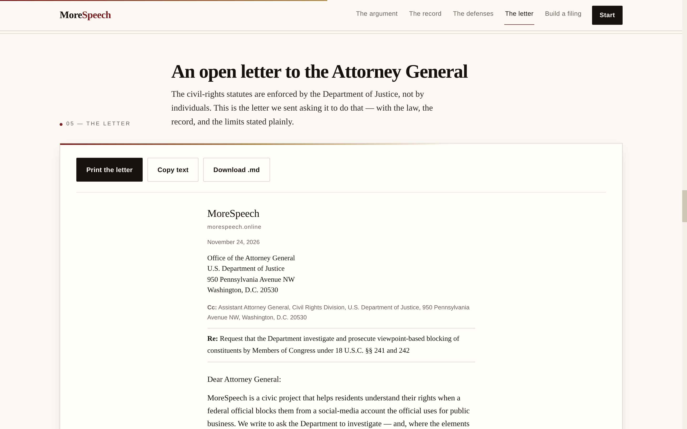 | 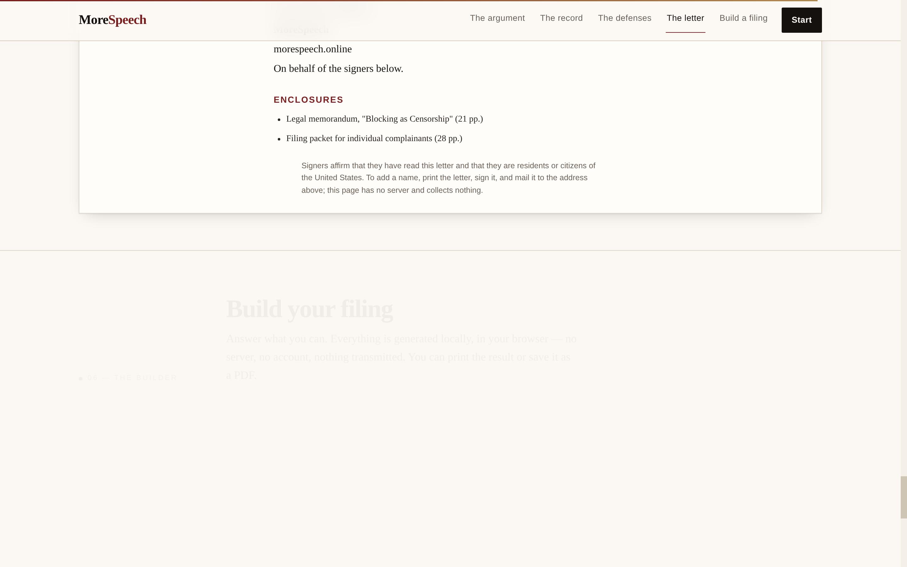 |
| **The letter.** The open letter to the Attorney General, in full. | **The builder.** Step one, with the live caption preview. |
| 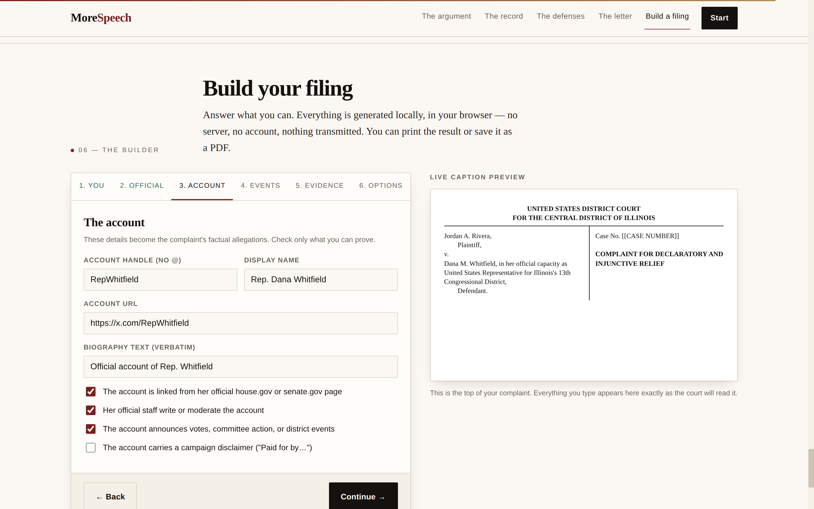 | 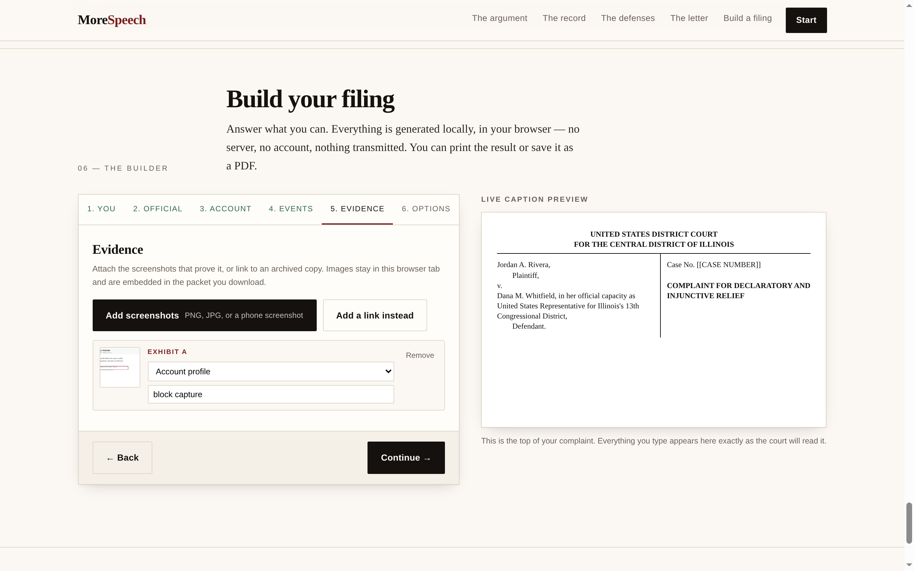 |
| **The indicia.** What makes an account official, as checkboxes that become allegations. | **Evidence.** A screenshot uploaded and lettered Exhibit A. |
| 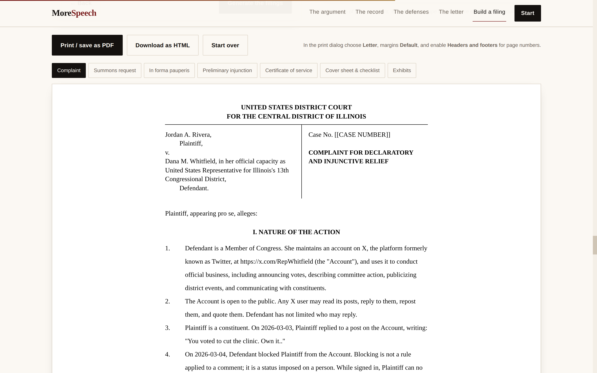 | 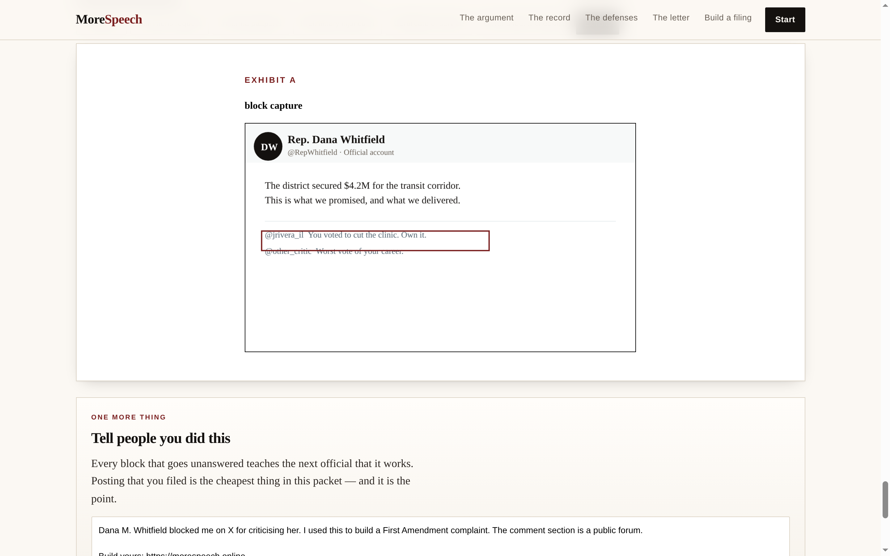 |
| **The output.** The complaint in court formatting: 12-point Times, double-spaced, caption block. | **The exhibit.** The capture printed under its own tab. |
| 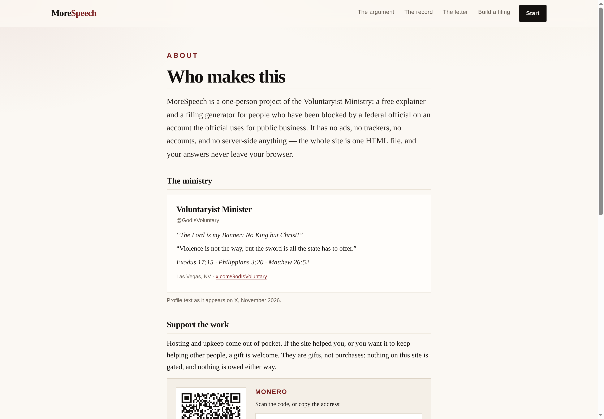 | 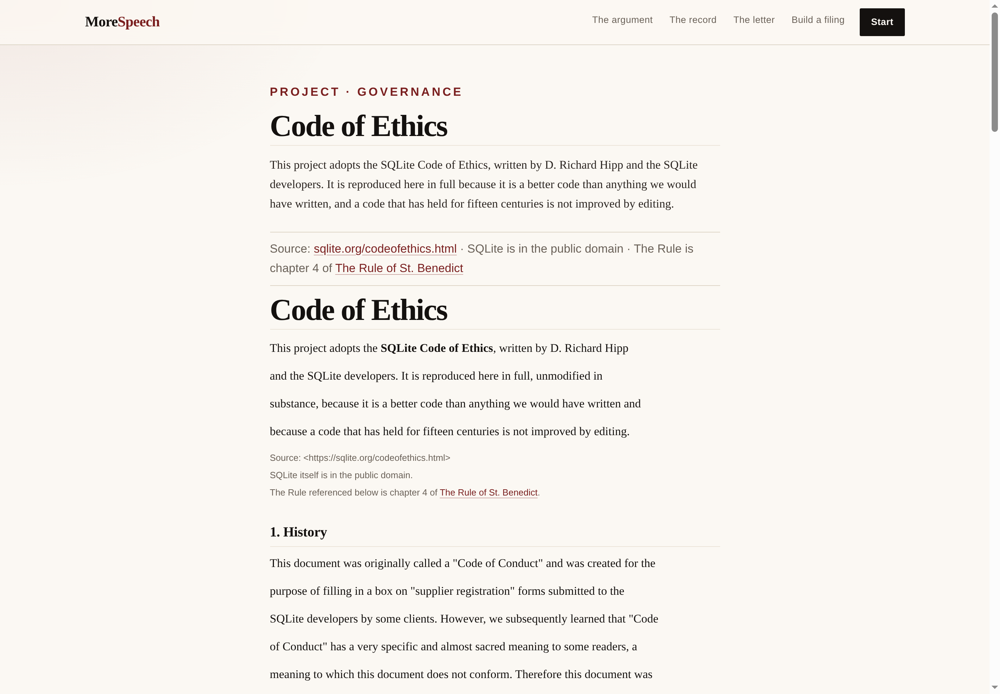 |
| **About.** The ministry, the profile as it appears on X, and how to send a gift. | **Code of Ethics.** SQLite's, reproduced whole. |
| 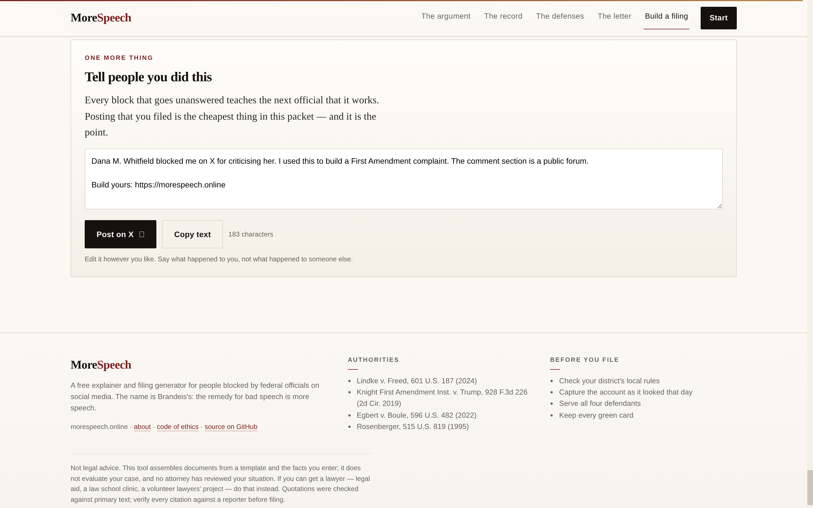 | 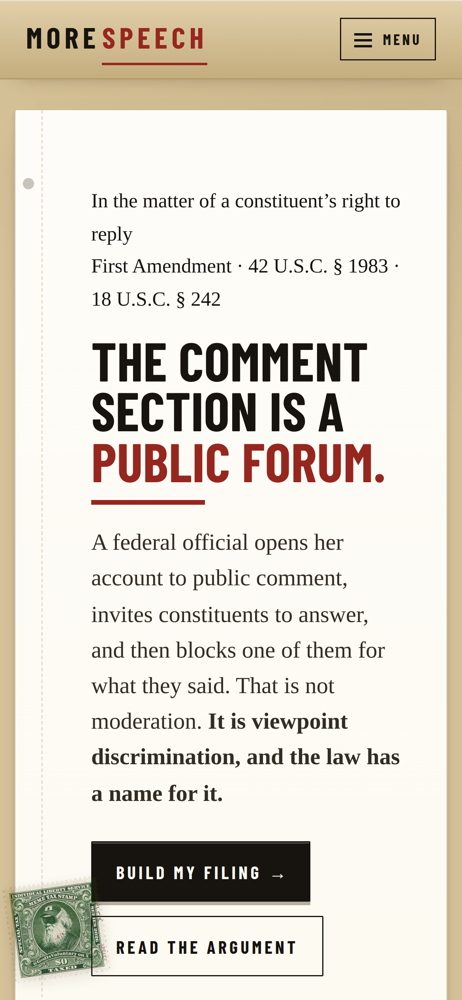 |
| **The share prompt.** A drafted post, editable, sent through X's intent URL. | **Mobile.** 390 pixels wide, no horizontal overflow. |

## What the site does

1. **States the argument in five links.** Government action → public forum →
   viewpoint discrimination → the defenses → the remedy. Each opens to the
   authority, quoted.
2. **Reports the record.** Twenty-two coded blocking suits, their outcomes, and
   what actually happened — five merits wins, no damages awards.
3. **Answers the three defenses** every defendant raises: personal account,
   government speech, Speech or Debate.
4. **Publishes the open letter** to the Attorney General asking the Department
   to investigate and, where the elements are met, prosecute.
5. **Builds the filings.** A six-step form with a live caption preview and an
   evidence step that letters your screenshots as exhibits. Output prints in
   court format or downloads as a self-contained HTML file.

## The legal argument

**The violation.** A federal official maintains an account that carries her
office, that her staff operate, and that she uses to announce votes, committee
action, and district business. She leaves the reply function open to the public
without limitation. A constituent replies critically; she blocks him. That
block is not moderation of a comment — it is a status imposed on a person,
durable and total, chosen because of the view that person expressed.

**The chain, link by link.**

1. **Government action.** *Lindke v. Freed*, 601 U.S. 187, 198 (2024), requires
   authority to speak for the government plus its exercise. The same opinion
   closes the escape hatch: "An official cannot insulate government business
   from scrutiny by conducting it on a personal page." *Id.* at 202 n.2.
2. **Public forum.** An account "intentionally opened for public discussion,"
   used "as an official vehicle for governance," with interactive features
   "accessible to the public without limitation," is a public forum.
   *Knight First Amendment Institute v. Trump*, 928 F.3d 226, 236 (2d Cir. 2019).
   The official's own posts may be government speech; the replies are not.
   *Id.* at 239.
3. **Viewpoint discrimination.** "Viewpoint discrimination is thus an egregious
   form of content discrimination," and the government "must abstain from
   regulating speech when the specific motivating ideology or the opinion or
   perspective of the speaker is the rationale for the restriction."
   *Rosenberger v. Rector & Visitors of the Univ. of Va.*, 515 U.S. 819, 829
   (1995); *accord Cornelius*, 473 U.S. 788, 806 (1985). It is barred in every
   forum, including a nonpublic one.
4. **The defenses fail.** Government speech does not reach who may answer.
   A "personal" account defense gets worse on a mixed account, because blocking
   is page-wide: a block aimed at a critic necessarily reaches the official
   posts too. *Lindke*, 601 U.S. at 202. The Speech or Debate Clause protects
   legislative acts, not the administration of a comment channel —
   a Senator's newsletters and press release were held unprotected in
   *Hutchinson v. Proxmire*, 443 U.S. 111, 130 (1979).
5. **The remedy is an order, not a check.** *Egbert v. Boule*, 596 U.S. 482
   (2022), forecloses a *Bivens* damages claim for First Amendment retaliation
   against a federal officer. What remains is a declaration, an injunction, and
   — against state or local officials, or federal officers acting jointly with
   them — § 1983.

**The criminal layer.** 18 U.S.C. § 242 punishes whoever, "under color of any
law," "willfully subjects any person … to the deprivation of any rights …
secured … by the Constitution." The statute says *any* law, and the Supreme
Court read it that way: "He who acts under color of law may be a federal
officer or a state officer." *Screws v. United States*, 325 U.S. 91, 108 (1945).
18 U.S.C. § 241 reaches the coordination, and contains a retaliation clause
written in 1870 — injury "because of his having so exercised the same."

**What is unsettled, stated plainly.** No appellate decision has yet applied
§ 242 to expressive conduct by a federal officer. That federal officers are
covered is settled; that viewpoint exclusion from a comment thread is the kind
of deprivation § 242 reaches is a reading of the text, not a holding. That is
why [`docs/open-letter.md`](docs/open-letter.md) asks the Department of Justice
for an investigation and published criteria rather than for a particular
indictment.

Full treatment, with the adverse authority at full strength, is in
[`docs/the-argument.md`](docs/the-argument.md).

## Navigation and deep links

The page opens at the top and remembers nothing about your last scroll. Sections
are addressable: `#argument`, `#record`, `#defenses`, `#stakes`, `#letter`,
`#builder`, and individual builder steps as `#builder-0` through `#builder-5`.

## Build

Requires Node with TypeScript and esbuild available (`TSC` and `ESBUILD`
environment variables override the binary paths).

```sh
npm i --no-save typescript esbuild
node build.mjs
```

That runs `tsc --strict` over `src/`, bundles `src/app.ts` with esbuild, inlines
the CSS and JS into `src/index.template.html`, and writes:

- `index.html` — the artifact GitHub Pages serves
- `docs/open-letter.md` — regenerated from `src/letter.ts`, so the site and the
  Markdown can never disagree

## Test

```sh
node test/smoke.mjs file:///path/to/index.html shot.png   # walks the builder, checks for console errors
node test/print.mjs file:///path/to/index.html out.pdf    # prints the filings; checks pagination and exhibits
node test/tour.mjs  file:///path/to/index.html screenshots # recaptures the gallery
```

The tests drive Chrome over CDP (`CDP_URL`, default `http://127.0.0.1:9223`).

## Deploy

This repository is a GitHub Pages user site: the branch root is published as-is,
so `index.html` at the root is the site.

```sh
git push origin main
```

Pages rebuilds on push. The site is served at
`https://morespeechonline.github.io/` until the custom domain is pointed.

**When DNS is ready**, add a file named `CNAME` at the root containing the
bare domain:

```
morespeech.online
```

and point an `A`/`ALIAS` record at GitHub Pages. Do not add `CNAME` before the
DNS records exist: GitHub redirects the `*.github.io` URL to the custom domain
as soon as the file is present, which makes the site unreachable in the
interval. The page's canonical URL and social metadata already name
`morespeech.online`; see `src/index.template.html`.

## Design notes

- **Progressive, no framework.** The bundle is a plain IIFE. The page works
  offline and from `file://`.
- **Nothing leaves the device.** Form state is kept in `localStorage` and the
  filings are assembled in memory. Evidence images are deliberately *not*
  persisted — only their captions and roles — so a screenshot of a live dispute
  does not sit in browser storage after the tab closes.
- **Print is the output.** `@media print` hides the app and reveals the
  generated documents: letter paper, one-inch margins, 12-point Times,
  double-spaced, caption block with rules, hanging numbered paragraphs.
- **Honesty is a feature.** The record section reports the losses as well as the
  wins, because a filing drafted on a false promise of money is a filing that
  gets dismissed.

## Support

MoreSpeech is free, has no ads, no tracking, and no server. If it helped you,
or if you want it to keep helping other people, gifts can be sent two ways:

**Monero**

```
84nBWg1DujcRSNVvBPnetNJPfFKvEKo5xfcRHvXLDhkeFF6osiPYJ5V399WKUT6wzN8tg5JqQWrLJhVgAytcmnha5GtYzJ3
```


**X Cash**

Send to **@GodIsVoluntary** on X.

The QR code encodes `monero:` followed by the address above, so a wallet can scan it
directly. Gifts go to the Voluntaryist Ministry and support the hosting and upkeep of this
site. Nothing here is a charitable contribution for tax purposes, and nothing is
owed — the letter, the argument, and the generator are free to use, copy, and
fork without giving anything.

## How it was made

The entire site — the argument, the case record, the letter, the filing templates, the
TypeScript, the styles, and the tests — was developed by **DeepSeek V4.1 Flash** running
in [omp.sh](https://omp.sh). The legal content was checked against primary sources during
the build: quotations come from the reporters and the statutes, not from memory.

## Contributing

Corrections to the law are the most valuable contribution: a citation that is
wrong, a holding that has been overtaken, a court that has split. Open an issue
with the authority. The [Code of Ethics](CODE_OF_ETHICS.md) governs how we treat
each other here; rule 28 applies to citations in particular.

## License

MIT — see [LICENSE](LICENSE). The prose in `docs/` is offered under the same
terms.

## Not legal advice

This is an educational tool. It assembles documents from a template and the
facts you enter; it does not evaluate your case, and no attorney has reviewed
your situation. If you can get a lawyer — legal aid, a law school clinic, a
volunteer lawyers' project — do that instead.
